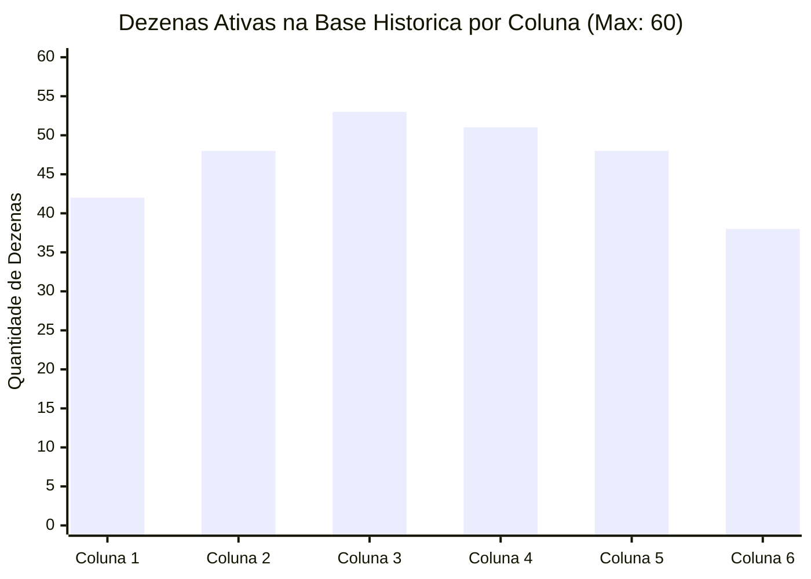
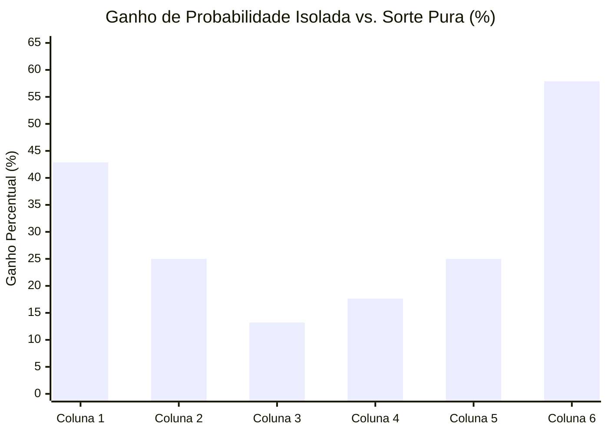
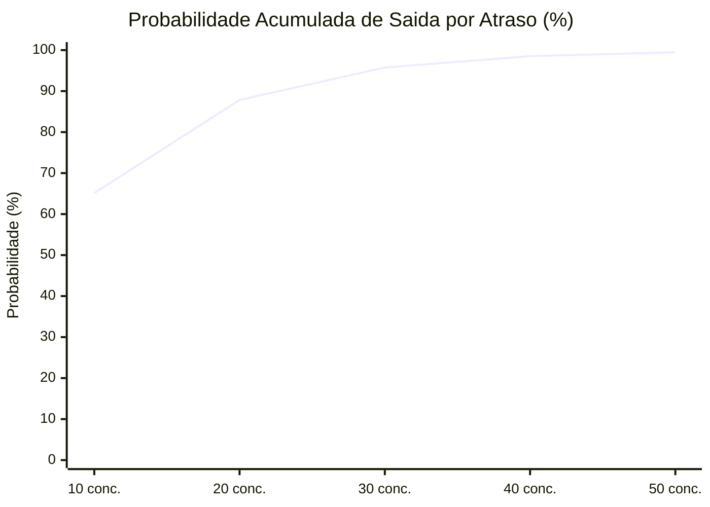
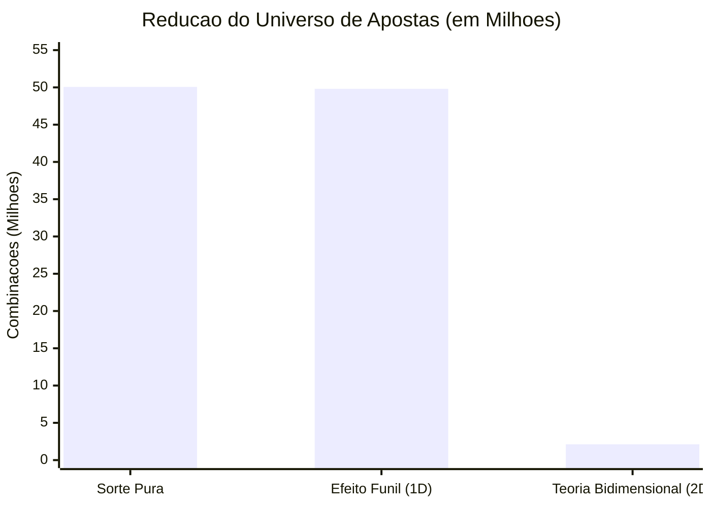
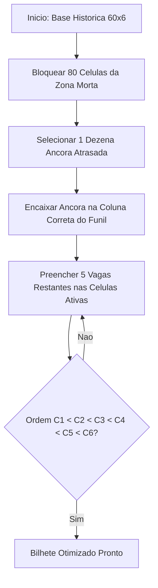

# 💬 Histórico Completo da Conversa com a IA

[LINK DA CONVERSA](https://github.com/thiagoschnell/robodamegasena-opensource/blob/main/Hist%C3%B3rico%20Completo%20da%20Conversa%3A%20Revis%C3%A3o%20de%20Prompts%20e%20Teoria%20da%20Mega-Sena)
---

> ### 📌 **Registro Oficial e Revisado**
> **Compilação integral** dos prompts, análises probabilísticas e desenvolvimento da **Teoria: O Efeito Funil da Ordem Crescente**, ancorada em **fundamentos estatísticos e axiomas matemáticos** como a **Lei dos Grandes Números**, além das sugestões de evolução da teoria propostas pelo Google, como os modelos **Nível 1.5** e **Nível 2** no link da conversa.
>
> 💡 *Nota: Esta é apenas uma das teorias que o robô da Mega-Sena utilizava.*

---

# 📊 Teoria do Efeito Funil da Ordem Crescente (Mega-Sena)
[Acessar a Documentação](https://github.com/thiagoschnell/robodamegasena-opensource/blob/main/Teoria%20do%20Efeito%20Funil%20da%20Ordem%20Crescente%20(Mega-Sena))

Estudo estatístico e matemático baseado na **Estatística de Ordem** aplicada aos resultados históricos da Mega-Sena (Concurso 0001 ao 2624).

## 🎯 O Fundamento da Teoria
Quando os 6 números sorteados são organizados em **ordem crescente** ($C_1 < C_2 < C_3 < C_4 < C_5 < C_6$), surge uma compressão natural nas extremidades do volante:
* **Coluna 1 (Menor número):** Concentra-se entre `01` e `50` (42 dezenas ativas, 18 cortadas).
* **Coluna 6 (Maior número):** Concentra-se entre `22` e `60` (38 dezenas ativas, 22 cortadas).
* **Zona Morta:** Ao todo, **80 posições** na matriz $60 \times 6$ nunca ocorreram na base histórica.

## 📈 Ganho de Probabilidade por Coluna

| Coluna | Dezenas Ativas | Dezenas Cortadas | Chance Isolada | Ganho vs. Sorte Pura |
| :--- | :---: | :---: | :---: | :---: |
| **Coluna 1** | 42 | 18 | 2,38% (1 em 42) | **+42,86%** |
| **Coluna 2** | 48 | 12 | 2,08% (1 em 48) | **+25,00%** |
| **Coluna 3** | 53 | 7 | 1,89% (1 em 53) | **+13,21%** |
| **Coluna 4** | 51 | 9 | 1,96% (1 em 51) | **+17,65%** |
| **Coluna 5** | 48 | 12 | 2,08% (1 em 48) | **+25,00%** |
| **Coluna 6** | 38 | 22 | 2,63% (1 em 38) | **+57,89%** |

## ⚙️ Os 3 Pilares Operacionais
1. **Trava de Fronteira:** Bloqueio absoluto das 80 células da zona morta.
2. **Progressão Estrita:** Garantia de que $C_1 < C_2 < C_3 < C_4 < C_5 < C_6$.
3. **Filtro de Combinações:** Eliminação de **255.966 jogos extremos** improváveis do universo total.

  

# 📊 Teoria do Efeito Funil da Ordem Crescente & Modelo Bidimensional (Mega-Sena)
[Acessar a Documentação](https://github.com/thiagoschnell/robodamegasena-opensource/blob/main/Teoria%20Bidimensional%3A%20Efeito%20Funil%20%2B%20%C3%82ncora%20Temporal%20%20(Mega-Sena))

Estudo estatístico e matemático baseado na **Estatística de Ordem** e na **Lei dos Grandes Números**, validado com a base histórica da Mega-Sena (Concurso 0001 ao 2624).

---

## 🎯 1. O Fundamento: Teoria do Efeito Funil (1D)

Quando os 6 números sorteados são organizados em **ordem crescente** ($C_1 < C_2 < C_3 < C_4 < C_5 < C_6$), surge uma compressão natural nas extremidades do volante:
* **Coluna 1 (Menor número):** Concentra-se entre `01` e `50` (**42 dezenas ativas**, 18 cortadas).
* **Coluna 6 (Maior número):** Concentra-se entre `22` e `60` (**38 dezenas ativas**, 22 cortadas).
* **Zona Morta:** Ao todo, **80 posições** na matriz $60 \times 6$ nunca ocorreram na base histórica, eliminando **255.966 combinações extremas**.

### Gráfico 1: Dezenas Ativas por Coluna (Anatomia do Funil)

### Gráfico 2: Ganho de Probabilidade Isolada por Coluna (%)

### Tabela Resumo do Efeito Funil (Concurso 0001 ao 2624)

| Coluna | Dezenas Ativas | Dezenas Cortadas | Faixa Ativa | Chance Isolada | Ganho vs. Sorte Pura |
| :--- | :---: | :---: | :---: | :---: | :---: |
| **Coluna 1** | 42 | 18 | 01 a 50 | 2,38% (1 em 42) | **+42,86%** |
| **Coluna 2** | 48 | 12 | 02 a 51 | 2,08% (1 em 48) | **+25,00%** |
| **Coluna 3** | 53 | 7 | 03 a 56 | 1,89% (1 em 53) | **+13,21%** |
| **Coluna 4** | 51 | 9 | 08 a 58 | 1,96% (1 em 51) | **+17,65%** |
| **Coluna 5** | 48 | 12 | 11 a 59 | 2,08% (1 em 48) | **+25,00%** |
| **Coluna 6** | 38 | 22 | 22 a 60 | 2,63% (1 em 38) | **+57,89%** |

---

## ⏳ 2. Evolução: Teoria Bidimensional (Espaço + Tempo)

A **Teoria Bidimensional** cruza duas dimensões estatísticas distintas para potencializar a seleção sem cair na armadilha de jogar vários números atrasados juntos:
1. **Dimensão Espacial (Efeito Funil):** Garante que todas as dezenas respeitem as zonas ativas das 6 colunas ($C_1 < C_2 < C_3 < C_4 < C_5 < C_6$).
2. **Dimensão Temporal (Dezena Âncora):** Seleciona **apenas 1 dezena atrasada** globalmente (complementação) e a encaixa na sua coluna de origem no Funil.

### Gráfico 3: Pressão Temporal por Concursos de Atraso (%)

### Gráfico 4: Comparativo Global de Universo (Milhões de Combinações)

### Comparativo Direto dos Modelos

| Critério | 1. Global: Sorte Pura | 2. Efeito Funil (1D) | 3. Teoria Bidimensional (2D) |
| :--- | :---: | :---: | :---: |
| **Dimensões** | Aleatório | Espaço (Colunas) | **Espaço + Tempo (1 Âncora)** |
| **Combinações Válidas** | 50.063.860 | 49.807.894 | **2.116.708** |
| **Combinações Cortadas** | 0 (0,00%) | 255.966 (0,51%) | **47.947.152 (95,77%)** |
| **Ganho de Concentração** | Base (1,00x) | +0,51% (1,005x) | **+2.265,18% (23,65x)** |

---

## ⚙️ 3. Fluxograma Operacional do Algoritmo

